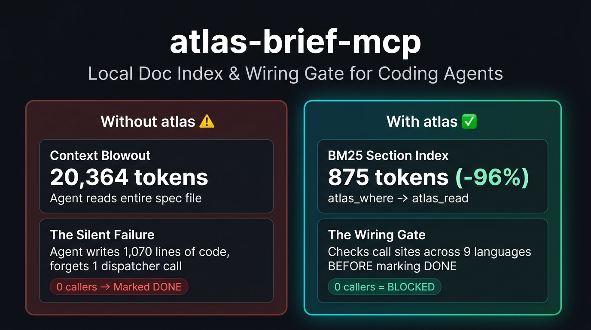

# atlas

[](https://github.com/drproof/atlas-brief-mcp/actions/workflows/tests.yml)
[](https://pypi.org/project/atlas-brief-mcp/)
[](https://glama.ai/mcp/servers/drproof/atlas-brief-mcp)
[](https://www.python.org/)
[](LICENSE)

**Project documentation as an index and a wiring gate — not as context fuel.**

[Why atlas](#-the-refusal-why-atlas-exists) · [Measured Benchmarks](#-measured-benchmarks) · [30s Quickstart](#-30-second-quickstart) · [Bootstrap (`atlas init`)](#-bootstrap-an-existing-repository) · [MCP Client Setup](#-mcp-client-setup) · [The 16 Tools](#-the-16-tools) · [Google Docs & Sheets](#-google-docs--sheets-optional)



---

`atlas` is a local MCP server for coding agents. Ask *"where is the damage model described?"* and get back a file, a line, and a section anchor (~60 tokens) — instead of dumping 20,000+ tokens of raw Markdown into the context window.

When the agent finishes a task and tries to mark a work order `✅ DONE`, `atlas` checks the codebase first: **if the target function or class is defined with zero callers/references, the checkoff is refused.**

```text
┌──────────────┐    ~60 tok     ┌──────────────┐   section only   ┌─────────────────┐
│ atlas_where  │ ─────────────► │  atlas_read  │ ───────────────► │ atlas_code_find │
│ (BM25 / FTS5)│                │  (by anchor) │                  │  (9 languages)  │
└──────────────┘                └──────────────┘                  └────────┬────────┘
                                                                           │
       ┌───────────────────────────────────────────────────────────────────┘
       ▼
┌──────────────────────────────────────────────────────────┐
│ atlas_publish / atlas_set_status  (Wiring Gate)          │
│  ├─ callers > 0  ──► Write ✅ DONE + verify read-back    │
│  └─ callers == 0 ──► REFUSE write ("defined, 0 callers") │
└──────────────────────────────────────────────────────────┘
```

Works 100% offline with any folder of Markdown (`docs/`, `specs/`, `adr/`, `gdd/`) — plus optional live sync for multi-tab Google Docs and Google Sheets.

---

## 🛑 The Refusal (Why `atlas` Exists)

`atlas` exists because of a specific production failure. An agent implemented 1,070 lines, forgot the single dispatcher call that made them reachable, and reported *"done"*. The next cleanup run saw an unused-function warning and deleted all of it — the lines were never committed, so nothing could be recovered. Nobody had asked the question `atlas` now asks before every checkoff: **is this actually wired up?**

That failure has a shape, and `atlas` answers it with a hard refusal instead of a warning nobody reads:

```json
{
  "written": false,
  "refused": true,
  "refusal": "Acceptance refused — wiring check failed:\n  ✗ '_dispatch_unit_class_skill' is defined in scripts/turn_manager.gd:3774 but never called or bound (0 calls, 0 references)\n\nA ✅ without a caller documents an intention, not a result."
}
```

That check runs **before** any network or filesystem write, so it costs nothing when it blocks. It has caught this exact class of mistake twice in real use.

---

## 📊 Measured Benchmarks

All numbers below were measured with `atlas measure` on a real production project (5-tab specification document, 124 sections, 218 source files) — no synthetic estimates:

| Task | Naive File Read (`Read` / `Grep`) | With `atlas` (SQLite FTS5 + AST/Regex) | Token Reduction |
|---|---:|---:|---:|
| **Answer one doc question** (`atlas_where` → `atlas_read`) | 20,364 tokens | **875 tokens** | **−96%** |
| **Locate 8 code symbols & callers** (`atlas_code_find`) | 291,447 tokens | **3,106 tokens** | **−99%** |
| **Inspect one symbol in a monolith file** | 74,522 tokens | **388 tokens** | **−99%** |
| **8-question benchmark run** (`atlas measure`) | 224,088 tokens | **5,945 tokens** | **−97%** |

### How `atlas` compares to other approaches

| Capability | Raw File Reads (`cat` / `Read`) | Read-Only Doc Indexers | `atlas` |
|---|---|---|---|
| **Granularity** | Full files (10k–70k tokens) | Section snippets (~300–1,000 tokens) | **~60-token pointers** (`atlas_where`) + on-demand sections (`atlas_read`) |
| **Search Engine** | Linear grep | Embeddings or basic FTS | **Local SQLite FTS5 (BM25)** + EN/DE compound & umlaut folding |
| **Code Symbol & Caller Lookup** | Manual grep across repo | ❌ None | ✅ **`atlas_code_find`** across 9 languages (definitions + call/ref counts) |
| **Dead-Code Wiring Gate** | ❌ Trusts agent self-report | ❌ Read-only | ✅ **Refuses `✅ DONE`** when `verify_symbols` has 0 callers |
| **Task & Work-Order State** | Lost when chat ends | ❌ None | ✅ **`atlas_status` / `atlas_tasks` / `atlas_brief`** persisted in docs |
| **Cloud & Privacy** | Local | Varies (often cloud embeddings) | **100% local & offline** (optional Google Docs/Sheets OAuth) |

---

## 🧠 Context That Survives the Chat

Every new agent session starts blind. It re-reads the repository, re-discovers where things live, re-derives what the current state is — and when the context window fills up, the next session starts over. The map lives in the conversation, and conversations are disposable.

`atlas` moves the map next to the code:

- **`atlas_where`** answers *"where is this documented?"* in one call — for any fresh chat.
- **`atlas_status`** says which work orders are done, so the checklist survives the session.
- **`atlas init`** writes the architecture down once instead of re-deriving it every week.
- **`atlas_set_status`** records the outcome in the document, not in the transcript.

You can close a chat mid-task and open a new one. The next session asks three questions and is up to speed in three tool calls, without reading a single file end to end.

**What it does not know** is what you *discussed*. A decision that was never written down is gone — which is the same rule as before, just applied to conversations: if it matters, it belongs in the document.

---

## ⚡ 30-Second Quickstart

Requires **Python 3.10+** and [uv](https://docs.astral.sh/uv/) (or `pipx`). No Google account, no API key, and no network access required.

### 1. Install from PyPI

```bash
# Recommended (installs `atlas` globally in an isolated environment)
uv tool install atlas-brief-mcp

# Or with pipx / pip
pipx install atlas-brief-mcp
pip install atlas-brief-mcp

# Or run directly without installing via uvx
uvx --from atlas-brief-mcp atlas --help
```

> **PATH note:** If `atlas` is not found after `uv tool install`, run `uv tool update-shell` once (or add `~/.local/bin` / `%USERPROFILE%\.local\bin` to your `PATH`).

### 2. Try it on the bundled demo project

```bash
atlas --root examples/demo doctor
atlas --root examples/demo where "Where is the damage model?"
atlas --root examples/demo brief "damage calculation"
```

Any folder of `.md` files works — `docs/`, `specs/`, `atlas/`, `gdd/`. The index lives in `<root>/.atlas/index.sqlite`, can be regenerated at any time, and your Markdown stays the source of truth.

---

## 🏗️ Bootstrap an Existing Repository

```bash
cd your-project
atlas init
```

Scans the repository — **no LLM, no network, under 0.3 seconds for 50 files** — and generates `docs/ARCHITECTURE.md` containing:

- **Domains**: every source folder with files, line counts, token estimates, and the largest functions per domain (not the first ones — those are getters).
- **Context hotspots**: files over 10,000 tokens that should never be read whole.
- **Unwired symbols**: functions over 15 lines whose name appears nowhere else — candidates for *"implemented but never connected"*.

It also writes `AGENTS.md`, `.antigravityrules`, `.mcp.json`, and adds `.atlas/` to `.gitignore` — **but only if they don't already exist.** `atlas init` never overwrites your rules.

```bash
atlas init --dry-run            # Preview what would be created, write nothing
atlas init --update             # Refresh metrics, hotspots & unwired symbols while keeping your notes & Work Orders
atlas init --hook               # Install a .git/hooks/pre-commit guard that runs `atlas check`
atlas init --out docs/ARCH.md   # Custom output path
atlas init --force              # Regenerate deliberately from scratch
```

`init` records what it created in `.atlas/managed.json`. `atlas lint` uses that to separate **managed** documents (must be clean, exit code `1`) from **discovered** legacy docs (reported as hints, exit code `0`).

### Supported Languages (9 Languages)

- **GDScript & Godot Scenes** (`.gd`, `.tscn`)
- **Python** (`.py`)
- **TypeScript / JavaScript** (`.ts`, `.tsx`, `.js`, `.jsx` — including `React.memo(...)` and `forwardRef<...>(...)` wrappers)
- **Rust** (`.rs`)
- **C#** (`.cs`)
- **Go** (`.go`)
- **Java & Kotlin** (`.java`, `.kt`)
- **Swift** (`.swift`)

Test functions (`test_*`, `Test*`, `*_test`) and framework-bound functions (`@decorator`, `@mcp.tool()`) are automatically excluded from unwired warnings.

### Writing Without Google (100% Local Loop)

`atlas init` creates `docs/ARCHITECTURE.md` with `Work Order 1 — ⬜ OPEN`. If no Google document is bound to the project, `atlas` writes straight into that local Markdown file — with the same contract, read-back verification, and `.atlas/mutations.log` audit trail:

```bash
# 1. Plan Work Orders (auto-links the matching spec section via atlas_where + writes - [ ] steps)
atlas plan "Damage model" --step "Apply armor curve" --step "Test crit multiplier" --symbols apply_damage
atlas plan "Dialogue conditions" --step "Parse flag expressions" --symbols eval_condition

# 2. Fetch the task brief for the next open Work Order — or the entire open queue (`atlas next+`)
atlas next                                                       # Brief for the next open (or 🚧) Work Order
atlas next+                                                      # Sequential execution queue for ALL open Work Orders

# 3. Check off steps and close the Work Order (blocks if steps are open or symbols have 0 callers)
atlas set-status --task "Apply armor curve" --status done        # - [ ] -> - [x] (WO shows 🚧 1/2 steps)
atlas set-status --task "Test crit multiplier" --status done     # - [ ] -> - [x] (2/2 steps)
atlas set-status --wo 2 --status done --verify-symbols apply_damage  # ⬜ OPEN -> ✅ DONE
atlas status                                                     # Reads the verified state + steps
atlas check                                                      # CI / pre-commit regression guard
```

---

## 🔌 MCP Client Setup

The server speaks standard MCP over `stdio`. Because `ATLAS_ROOT=.` resolves relative to the client's working directory, **one installation serves every project**.

### 1. Zero-Install via `uvx` (Claude Code / Cursor / Windsurf / Antigravity)

Runs directly from PyPI without pre-installing:

```json
{
  "mcpServers": {
    "atlas": {
      "command": "uvx",
      "args": ["--from", "atlas-brief-mcp", "atlas", "serve"],
      "env": { "ATLAS_ROOT": "." }
    }
  }
}
```

### 2. Local CLI Install (`.mcp.json` / `~/.gemini/config/mcp_config.json`)

If you installed `atlas` via `uv tool install atlas-brief-mcp` (or let `atlas init` create `.mcp.json`):

```json
{
  "mcpServers": {
    "atlas": {
      "command": "atlas",
      "args": ["serve"],
      "env": { "ATLAS_ROOT": "." }
    }
  }
}
```

### 3. Claude Desktop (`claude_desktop_config.json`)

Same block as above. On Windows, use `"command": "atlas.exe"` if the bare command name is not resolved.

> **Built-in Agent Guardrails:** On connect, `atlas` delivers its own MCP `instructions` telling the agent to route documentation lookups through `atlas_where` → `atlas_read` instead of `Read`/`Grep`, and to call `atlas_set_status` / `atlas_publish` only after tests pass.

---

## 🛠️ The 16 Tools

| Category | Tool | Purpose |
|---|---|---|
| **Read & Search** | `atlas_where` | Fast topic → file, line, heading & section anchor (~60 tokens) |
| **Read & Search** | `atlas_search` | Full-text BM25 search across all sections (EN + DE stop words & umlaut folding) |
| **Read & Search** | `atlas_read` | Read a single section by anchor (`offset` / `max_chars` budget control) |
| **Read & Search** | `atlas_outline` | Full table of contents across all indexed documents (or one `doc`) |
| **Read & Search** | `atlas_links` | Section cross-references, tags, sibling sections, and linked `implements:` code files |
| **Workflow & Briefs** | `atlas_plan` | Create an open Work Order with `- [ ]` steps, auto-linked to its spec anchor via `atlas_where` |
| **Workflow & Briefs** | `atlas_brief` | Build a task brief for the next open Work Order (or the full open queue via `all_open=True` / `atlas next+`) |
| **Workflow & Briefs** | `atlas_tasks` | List open/done Markdown checkbox tasks (`- [ ]` / `- [x]`), filterable by `@owner` |
| **Workflow & Briefs** | `atlas_status` | List all Work Orders (`⬜ OPEN`, `🚧 IN PROGRESS`, `✅ DONE`), spec anchors, steps, and `💡 ready to close` hints |
| **Code & Wiring** | `atlas_code_find` | Locate symbol definitions, signatures, optional function bodies (`include_body`), **and call/ref counts** across 9 languages |
| **Verified Writes** | `atlas_publish` | Append a verified Work Order status block — **blocks on `verify_symbols` with 0 callers** |
| **Verified Writes** | `atlas_set_status` | Flip a Work Order or `- [ ]` step — **blocks if child steps are open or symbols have 0 callers** |
| **Spreadsheets** | `atlas_sheets` | List indexed spreadsheet tabs, headers, and row keys |
| **Spreadsheets** | `atlas_sheet_update` | Update balancing cells by `row_key` + **column name** (never fragile `C14` coordinates) |
| **Spreadsheets** | `atlas_sheet_append` | Append new rows by column name mapping |
| **Diagnostics** | `atlas_lint` | Check docs for duplicate anchors, oversized sections, and broken `implements:` paths |

### Built-in MCP Prompts (`prompts/list`)

| Prompt | Arguments | Purpose |
|---|---|---|
| `atlas_onboard` | — | Token-saving project onboarding (`atlas_outline` + `atlas_status` + `atlas_tasks` without reading full files) |
| `atlas_task_brief` | `task`, `wo` (opt.) | Gather relevant spec sections, `implements:` code targets, and existing symbol callers before writing code |
| `atlas_pre_commit_audit` | `wo`, `symbols` | Pre-commit audit checklist (`atlas_lint`, `atlas_code_find` wiring check, and verified `atlas_set_status`) |

---

## ☁️ Google Docs & Sheets (Optional)

If your team's living documentation or balancing tables live in Google Docs and Sheets, `atlas` indexes and updates them through the official Google APIs — including multi-tab documents:

```bash
atlas auth                     # One-time OAuth consent in the browser
atlas sync --query MYPROJECT   # Pull documents & sheets into the local cache
atlas status
atlas publish --wo 7 --title "Mission 1" --desc "Rooms 1-9"
```

Three engineering details that prevent common agent accidents:

1. **Export to read, query directly to judge:** The search index is built from Drive exports, but post-write verification queries `documents.get` directly — because the Docs API is consistent immediately after `batchUpdate` while Drive export caches lag by 0.5–2 seconds.
2. **Append-only with revision lock:** `requiredRevisionId` prevents a write from landing on a stale document revision, and an idempotency guard prevents duplicate status headers when a work order already exists in the live doc.
3. **Tab-scoped status updates:** `replaceAllText` uses `tabsCriteria` so status changes only affect the active tab, never archive tabs.

---

## 📏 Measure It on Your Own Project

You don't have to take our benchmark numbers on faith — run the exact same measurement on your own repository:

```bash
cd your-project
atlas init          # Or point at existing docs
atlas measure       # Compares naive full-doc read vs. atlas index per question
```

```text
Documents: 4 · naive baseline: 28,011 tokens per question

Question                                           naive   atlas   saved
------------------------------------------------------------------------
Where is 7.6 Built engine features described?     28,011     885     97%
Where is 01_Units_Stats described?                28,011     689     98%
...
------------------------------------------------------------------------
Total                                            224,088   5,945     97%
```

By default, questions are derived from your section headings (which is optimistic because the question shares words with the heading — `atlas measure` explicitly notes this). For an independent benchmark, pass your own question list:

```bash
atlas measure --questions my-questions.txt    # One question per line
```

---

## 🧭 What `atlas` Is Not

- **Not a prose editor:** It writes verified status markers and spreadsheet rows/cells, not design prose.
- **Not a web crawler:** It indexes the documentation folders in your repository (and optional bound Google Docs).
- **Not a test replacement:** The wiring gate verifies that a symbol is defined and referenced/called — not that its logic is bug-free.

---

## 🧪 Automated Tests

```bash
uv run pytest -q                                           # 221 unit & integration tests (offline)
uv run python scripts/smoke_mcp.py --root examples/demo    # End-to-end JSON-RPC MCP smoke test
```

All 221 tests run completely offline. Every Google Docs & Sheets interaction is tested against deterministic fakes — including edge cases where the API swallows a write or lags on export.

## 📄 License

MIT — see [LICENSE](LICENSE).
